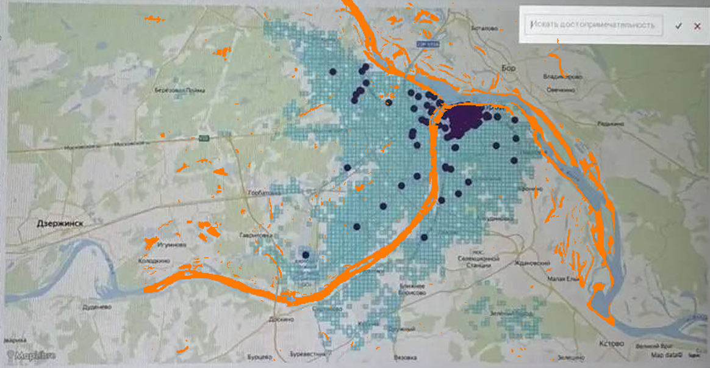

# Что означают точки на тепловой карте Нижнего Новгорода

**Самая надёжная интерпретация** — на экране одновременно включены слой интенсивности на квадратной сетке и знаки мест притяжения. Об этом говорят название раздела «Точки притяжения», заголовок карты и поле «Искать достопримечательность». Отдельная тёмная точка, вероятно, открывала объект каталога. На фотографии нет открытой карточки, идентификаторов или подписей самих объектов. Количество тёмных знаков не измеряет число людей. Время суток и методику учёта визитеров на снимке прочитать нельзя.

## Период и числа

В заголовке стоит 1–23 января 2025 года. Вверху выбрана территория «Все территории». Географический охват сводных чисел точнее не указан. Близость точки к месту сама по себе ничего не говорит о численности его посетителей.

| Показатель на экране | Человек | Доля от итога |
|---|---:|---:|
| Всего визитеров | 749 840 | 100 % |
| Туристов | 748 151 | 99,775 % |
| Экскурсантов | 1 689 | 0,225 % |

Проверка суммы даёт ровно 749 840. Шкала слева содержит подписи свыше 3,8, 12, 19, 27 и 35 тыс. Её начало бирюзовое, затем идут зелёный, охра и красно-коричневый. Точная величина, схема нормирования, размер расчётной ячейки и легенда тёмных значков отсутствуют. Фиолетовый цвет знаков не входит в цветовую последовательность шкалы. По этой причине крупное тёмное пятно нельзя интерпретировать как превышение 35 тысяч человек.

## Что удалось привязать к местности

- **Исторический центр, контур № 13.** Внутрь видимого контура проецируются справочные координаты Кремля, площади Минина и Пожарского, Чкаловской лестницы, Рождественской и Большой Покровской улиц. Центр контура смещён к югу от Кремля. Присвоение всему пятну имени одного объекта скрывало бы остальные возможные объекты. [Карта туристического портала региона](https://nn-tourist.ru/assets/content/doc/maps/karta-nizhnego-novgoroda.pdf)
- **Окрестности Стрелки, № 9.** Координаты Окской набережной и пакгаузов попадают в один и тот же небольшой знак при наложении слоёв. Это пример, где даже хорошая визуальная привязка не позволяет выбрать одно название. [Маршрут по Стрелке и ярмарке](https://nn-tourist.ru/stati/greenroute)
- **Нижегородская ярмарка, № 11.** Справочная точка ярмарки попадает в восточную часть группы. Центр всей группы отстоит от неё примерно на 270 м. [Официальная туристическая карта](https://nn-tourist.ru/assets/content/doc/maps/karta-nizhnego-novgoroda.pdf)
- **Вознесенский Печерский монастырь, № 12.** Справочная точка у входа отстоит от центра изолированного знака примерно на 130 м, что меньше радиуса знака в масштабе снимка. Монастырь подходит как кандидат для сверки с исходным каталогом. [Карточка Нижегородской митрополии](https://nne.ru/objects/voznesenskij-pecherskij-muzhskoj-monastyr/)
- **За пределами центра.** Несколько отметок образуют цепочку на северо-западе, в Сормовском районе. Обособленные отметки также видны на юге и востоке города. Справочные совпадения включают Светлоярский парк (№ 2), экспозицию «Паровозы России» (№ 23), музей истории ГАЗ (№ 30) и пассажирский терминал (№ 33). Таблица ниже приводит расстояния, альтернативы и источники. Светлые промежутки в сетке могут отражать как особенности данных, так и слабую различимость цвета на фото. Нулевую посещаемость они не доказывают.

## Как получены координаты и где теряется точность

1. Использован оригинальный JPEG размером 1171 × 603 пикселя. Для крупного плана взят участок со всеми различимыми тёмными отметками, исправлен наклон, применены интерполяция, небольшое повышение контраста и резкости. Фрагмент со шкалой сохранён отдельно. География для чистой карты берётся из местной копии OpenStreetMap. На исходной фотографии виден логотип MapLibre.
2. В растре OpenStreetMap выделены водные поверхности. Аффинное преобразование подобрано по контрасту вдоль их границ с учётом оттенка воды на фотографии. Опора — форма Оки на юге и Волги на севере и востоке. Карта и справочные границы районов основаны на выгрузках OSM ноября 2026 года. Геометрия служит ориентиром для фотографии за январь 2025 года. [Лицензия и авторство OpenStreetMap](https://www.openstreetmap.org/copyright)
3. В городской области исходного JPEG (x 675–921, y 231–448) отобраны пиксели, у которых все три канала меньше 96, а синий превышает красный более чем на 3. Соседство проверено по четырём сторонам. Отброшены фрагменты площадью меньше 15 пикселей. Область анализа выбрана после визуальной проверки всей карты. При порогах яркости 78, 84, 90, 96 и 102 число сохраняемых областей одинаково — 33. Их границы при этом меняются. Верхняя надпись города местами подходит близко к центральным знакам.
4. Получены 24 компактных контура, восемь вытянутых или соприкасающихся групп и одно большое слияние размером 56 × 43 пикселя. Эта классификация описывает форму. Уединённые значки обычно занимают 7–8 пикселей в поперечнике. В районе центра 1 исходный пиксель соответствует примерно 77 м, а ширина значка — порядку полукилометра.
5. При локальном сдвиге слоя водных границ на трёх участках наилучшее совпадение отличалось от общего решения на 0–1 пиксель. На прямом участке Оки вытянутый вдоль русла оптимум достиг края поискового окна в 6 пикселей. Это внутренняя проверка изображения, а не геодезическая оценка точности. Центры привязаны ориентировочно, до уровня городской зоны. Три знака после запятой в таблице нужны для воспроизведения положения на карте.
6. Для бирюзового слоя выделены наблюдаемые цвет и локальный рисунок сетки, водные поверхности приглушены. Отражения экрана, муар, JPEG-сжатие и перекрытие значками влияют на результат. Пустые участки не заполнялись расчётными значениями. Просмотр фотографии в приложении позволяет сверить край сетки и периферийные пятна в том же масштабе.

## Каталог видимых контуров

Нумерация тестовая, с севера фотографии к югу. Координаты относятся к центру видимого контура. Район определён по пересечению этого центра с полигоном OSM. Возле границы районов результат чувствителен к небольшому сдвигу. Варианты ориентиров подобраны из справочника по положению. Для подтверждения именования нужны карточка объекта или исходная выгрузка точек притяжения.

| № | Форма | Район | Широта ≈ | Долгота ≈ | Кандидаты и ориентиры поблизости |
|---:|---|---|---:|---:|---|
| 1 | Группа | Сормовский | 56.359 | 43.867 | Музей истории завода Красное Сормово (≈ 230 м), Сквер "Дружба" (≈ 480 м) |
| 2 | Компактная | Сормовский | 56.356 | 43.825 | Светлоярский парк (≈ 30 м) |
| 3 | Компактная | Сормовский | 56.348 | 43.871 | Центр Сормова (≈ 240 м), сквер Валерия Иконникова (≈ 270 м), сквер им. Ефремова (≈ 280 м) |
| 4 | Компактная | Канавинский | 56.341 | 43.932 | Вера (≈ 60 м) |
| 5 | Группа | Сормовский | 56.340 | 43.859 | Сормовский парк (≈ 190 м), Диноленд (≈ 230 м), Мадагаскар (≈ 410 м) |
| 6 | Группа | Канавинский | 56.339 | 43.959 | Совкомбанк Арена (≈ 360 м) |
| 7 | Компактная | Канавинский | 56.338 | 43.942 | Имя не установлено |
| 8 | Компактная | Московский | 56.334 | 43.902 | Галерея кукол "Хрупкие мечты" (≈ 90 м) |
| 9 | Компактная | Канавинский | 56.334 | 43.971 | Окская набережная и Стрелка, Пакгаузы на Стрелке. Стрелка (≈ 170 м), Ярмарочная водозаборная станция (≈ 230 м), Выставочный пакгауз (≈ 250 м) |
| 10 | Компактная | Канавинский | 56.329 | 43.936 | Имя не установлено |
| 11 | Группа | Канавинский | 56.329 | 43.957 | Нижегородская ярмарка. Сквер Августина Бетанкура (≈ 40 м), Главный ярмарочный дом (≈ 260 м), Нижегородская ярмарка (≈ 270 м) |
| 12 | Компактная | Нижегородский | 56.324 | 44.049 | Вознесенский Печерский монастырь. Святовознесенский Печёрский мужской монастырь (≈ 80 м), Романовы (≈ 90 м) |
| 13 | Скопление | Нижегородский | 56.322 | 44.004 | Кремль, площадь Минина и Пожарского, Чкаловская лестница, Большая Покровская и другие |
| 14 | Компактная | Нижегородский | 56.321 | 44.073 | Имя не установлено |
| 15 | Группа | Канавинский | 56.320 | 43.950 | Нижегородский цирк (≈ 270 м), Императорский павильон (≈ 310 м), Планетарий (≈ 340 м) |
| 16 | Группа | Нижегородский | 56.316 | 43.974 | Имя не установлено |
| 17 | Группа | Канавинский | 56.311 | 43.934 | Парк имени 1 Мая (≈ 20 м), Собранье крепких напитков (≈ 150 м), Музей пожарной части (≈ 220 м) |
| 18 | Компактная | Нижегородский | 56.308 | 44.074 | Имя не установлено |
| 19 | Компактная | Ленинский | 56.302 | 43.940 | Площадь Железнодорожников (≈ 110 м), Театр музыкально-пластической драмы «Преображение» (≈ 130 м) |
| 20 | Компактная | Советский | 56.302 | 44.048 | Музей истории, МП Нижегородэлектротранс (≈ 80 м) |
| 21 | Компактная | Советский | 56.300 | 43.992 | Имя не установлено |
| 22 | Компактная | Нижегородский | 56.291 | 44.072 | Имя не установлено |
| 23 | Компактная | Канавинский | 56.285 | 43.846 | Паровозы России (≈ 150 м) |
| 24 | Группа | Советский | 56.285 | 43.982 | Планетарий 1 (≈ 460 м), Планетарий (≈ 460 м) |
| 25 | Компактная | Ленинский | 56.279 | 43.940 | Парк Станкозавода (≈ 130 м) |
| 26 | Компактная | Советский | 56.275 | 44.010 | Музей архитектуры и быта народов нижегородского поволжья (≈ 90 м), Музей деревянного зодчества (≈ 120 м) |
| 27 | Компактная | Ленинский | 56.272 | 43.919 | Дубки (≈ 400 м) |
| 28 | Компактная | Приокский | 56.266 | 43.997 | Пиано (≈ 90 м) |
| 29 | Компактная | Приокский | 56.261 | 43.974 | Музей истории Приокского района (≈ 110 м) |
| 30 | Компактная | Автозаводский | 56.256 | 43.894 | Музей истории Горьковского автомобильного завода (≈ 230 м) |
| 31 | Компактная | Автозаводский | 56.241 | 43.859 | Площадь имени И.И. Киселёва (≈ 210 м), Чиполлино (≈ 330 м), Автозаводский парк культуры и отдыха (≈ 370 м) |
| 32 | Компактная | Приокский | 56.233 | 43.950 | Музей-квартира А.Д. Сахарова (≈ 120 м) |
| 33 | Компактная | Автозаводский | 56.219 | 43.790 | Терминал 2 (≈ 60 м) |

## Что проверяет тестовая версия

На карте можно менять масштаб, перемещаться, выбирать контур, искать по номеру, району и известному названию. Два режима позволяют переключиться между фотографией и реконструкцией с сохранением положения. Справочные ориентиры включаются отдельным слоем. Отчёт JSON сохраняет источник, период, показатели и различимые отметки.

Календарь и время суток выбирают точный срез. У фотографии один доступный период. Другие даты показывают отсутствие данных. При загрузке файла с реальными срезами работают переход между периодами, просмотр клеток с числом визитеров и выбор именованных точек. Встроенная фотография не содержит ряда по дням, разбивки по часам, исходных чисел по ячейкам или данных для остальных разделов административной панели. Выгрузка от владельца системы нужна для точного воспроизведения этих разделов и рейтингов. [Формат файла с данными](format.md)

## Пространственная сверка открытого каталога

В выгрузке от 20 ноября 2026 года OpenStreetMap рассмотрены 243 именованных записей в пределах городской зоны. Отобраны музеи, галереи, аттракционы, зоопарки, парки, стадионы, театры, планетарии и терминалы. Для точечных объектов использованы координаты узла. Для зданий и территорий — центр ограничивающего прямоугольника Overpass. Он может находиться далеко от входа.

Кандидат включён, если его справочная точка лежит в контуре либо отстоит от его пикселей максимум примерно на 185 м и от центра максимум на 550 м. Для каждой области оставлены до трёх ближайших записей по центру. Порог отсекает дальние объекты и не является оценкой точности геопривязки. Центральное слияние рассмотрено отдельно выше. При этих условиях найдены ориентиры для **25 из 32 периферийных контуров**. Не каждая достопримечательность имеет запись в использованных категориях OSM.

Расстояние от центра отметки округлено до 10 м для сравнения кандидатов. Исходный пиксель соответствует примерно 77 м. Помета «поздняя версия» означает, что версия справочной записи обновлена после даты отчёта и январское название требует отдельной сверки. Ранняя версия подтверждает наличие записи в OSM к январю 2025 года. Изменения геометрии вложенных элементов OSM возможны. Связь с закрытым каталогом исходной панели остаётся гипотезой во всех случаях.

| Контур | Открытый ориентир | Расстояние от центра ≈ | Версия справочной записи |
|---:|---|---:|---|
| 1 | [Музей истории завода Красное Сормово](https://www.openstreetmap.org/node/1808680322) | 230 м | 2025-06-19 · поздняя версия |
| 1 | [Сквер "Дружба"](https://www.openstreetmap.org/way/627182628) | 480 м | 2023-12-29 |
| 2 | [Светлоярский парк](https://www.openstreetmap.org/relation/3538074) | 30 м | 2014-02-26 |
| 3 | [Центр Сормова](https://www.openstreetmap.org/node/11185613226) | 240 м | 2023-09-12 |
| 3 | [сквер Валерия Иконникова](https://www.openstreetmap.org/way/627182662) | 270 м | 2023-12-30 |
| 3 | [сквер им. Ефремова](https://www.openstreetmap.org/way/1353722231) | 280 м | 2025-01-23 |
| 4 | [Вера](https://www.openstreetmap.org/way/169674758) | 60 м | 2026-05-31 · поздняя версия |
| 5 | [Сормовский парк](https://www.openstreetmap.org/relation/546053) | 190 м | 2020-07-24 |
| 5 | [Диноленд](https://www.openstreetmap.org/way/437570276) | 230 м | 2016-08-17 |
| 5 | [Мадагаскар](https://www.openstreetmap.org/relation/5344863) | 410 м | 2015-07-07 |
| 6 | [Совкомбанк Арена](https://www.openstreetmap.org/relation/5317016) | 360 м | 2025-12-23 · поздняя версия |
| 8 | [Галерея кукол "Хрупкие мечты"](https://www.openstreetmap.org/node/12438209201) | 90 м | 2024-12-21 |
| 9 | [Стрелка](https://www.openstreetmap.org/relation/13108789) | 170 м | 2021-08-19 |
| 9 | [Ярмарочная водозаборная станция](https://www.openstreetmap.org/way/589335949) | 230 м | 2025-07-29 · поздняя версия |
| 9 | [Выставочный пакгауз](https://www.openstreetmap.org/node/11146567206) | 250 м | 2025-06-24 · поздняя версия |
| 11 | [Сквер Августина Бетанкура](https://www.openstreetmap.org/way/535154575) | 40 м | 2021-09-04 |
| 11 | [Главный ярмарочный дом](https://www.openstreetmap.org/relation/2129865) | 260 м | 2026-05-01 · поздняя версия |
| 11 | [Нижегородская ярмарка](https://www.openstreetmap.org/node/5289571922) | 270 м | 2022-06-30 |
| 12 | [Святовознесенский Печёрский мужской монастырь](https://www.openstreetmap.org/relation/3015727) | 80 м | 2025-07-13 · поздняя версия |
| 12 | [Романовы](https://www.openstreetmap.org/node/9084312519) | 90 м | 2021-09-12 |
| 15 | [Нижегородский цирк](https://www.openstreetmap.org/relation/2821198) | 270 м | 2020-10-21 |
| 15 | [Императорский павильон](https://www.openstreetmap.org/relation/2863650) | 310 м | 2025-04-04 · поздняя версия |
| 15 | [Планетарий](https://www.openstreetmap.org/way/47986270) | 340 м | 2023-10-22 |
| 17 | [Парк имени 1 Мая](https://www.openstreetmap.org/relation/2768698) | 20 м | 2024-03-23 |
| 17 | [Собранье крепких напитков](https://www.openstreetmap.org/node/11755592000) | 150 м | 2024-03-23 |
| 17 | [Музей пожарной части](https://www.openstreetmap.org/node/4247041929) | 220 м | 2016-06-16 |
| 19 | [Площадь Железнодорожников](https://www.openstreetmap.org/way/1152220610) | 110 м | 2023-03-06 |
| 19 | [Театр музыкально-пластической драмы «Преображение»](https://www.openstreetmap.org/node/3908569601) | 130 м | 2026-07-07 · поздняя версия |
| 20 | [Музей истории, МП Нижегородэлектротранс](https://www.openstreetmap.org/node/1808680324) | 80 м | 2017-10-26 |
| 23 | [Паровозы России](https://www.openstreetmap.org/way/45927288) | 150 м | 2021-09-09 |
| 24 | [Планетарий 1](https://www.openstreetmap.org/node/9332430217) | 460 м | 2024-04-23 |
| 24 | [Планетарий](https://www.openstreetmap.org/relation/17507681) | 460 м | 2024-04-23 |
| 25 | [Парк Станкозавода](https://www.openstreetmap.org/relation/2588172) | 130 м | 2012-11-21 |
| 26 | [Музей архитектуры и быта народов нижегородского поволжья](https://www.openstreetmap.org/relation/2199269) | 90 м | 2020-10-21 |
| 26 | [Музей деревянного зодчества](https://www.openstreetmap.org/node/4994480121) | 120 м | 2017-07-26 |
| 27 | [Дубки](https://www.openstreetmap.org/relation/2344349) | 400 м | 2018-06-14 |
| 28 | [Пиано](https://www.openstreetmap.org/node/1808422815) | 90 м | 2023-10-05 |
| 29 | [Музей истории Приокского района](https://www.openstreetmap.org/node/1808680319) | 110 м | 2012-07-01 |
| 30 | [Музей истории Горьковского автомобильного завода](https://www.openstreetmap.org/node/1808680326) | 230 м | 2024-08-27 |
| 31 | [Площадь имени И.И. Киселёва](https://www.openstreetmap.org/relation/3361676) | 210 м | 2025-07-10 · поздняя версия |
| 31 | [Чиполлино](https://www.openstreetmap.org/way/172689937) | 330 м | 2022-06-15 |
| 31 | [Автозаводский парк культуры и отдыха](https://www.openstreetmap.org/relation/2302969) | 370 м | 2023-08-28 |
| 32 | [Музей-квартира А.Д. Сахарова](https://www.openstreetmap.org/node/1808680332) | 120 м | 2025-07-23 · поздняя версия |
| 33 | [Терминал 2](https://www.openstreetmap.org/relation/7597625) | 60 м | 2022-06-03 |
